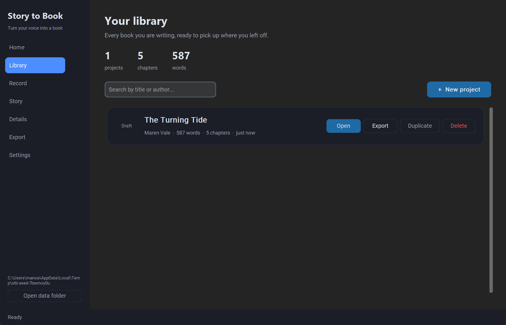
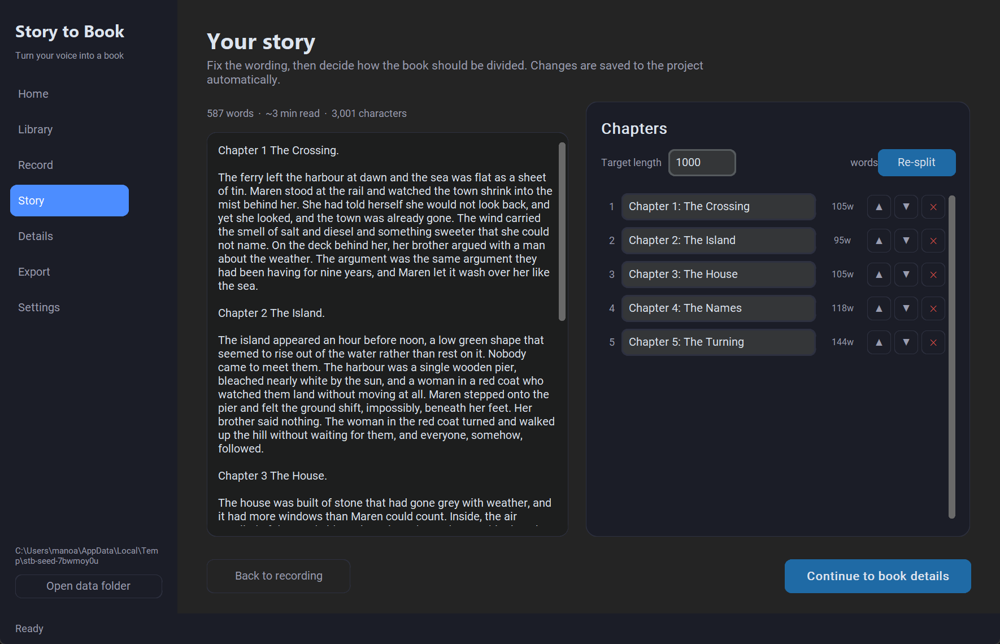
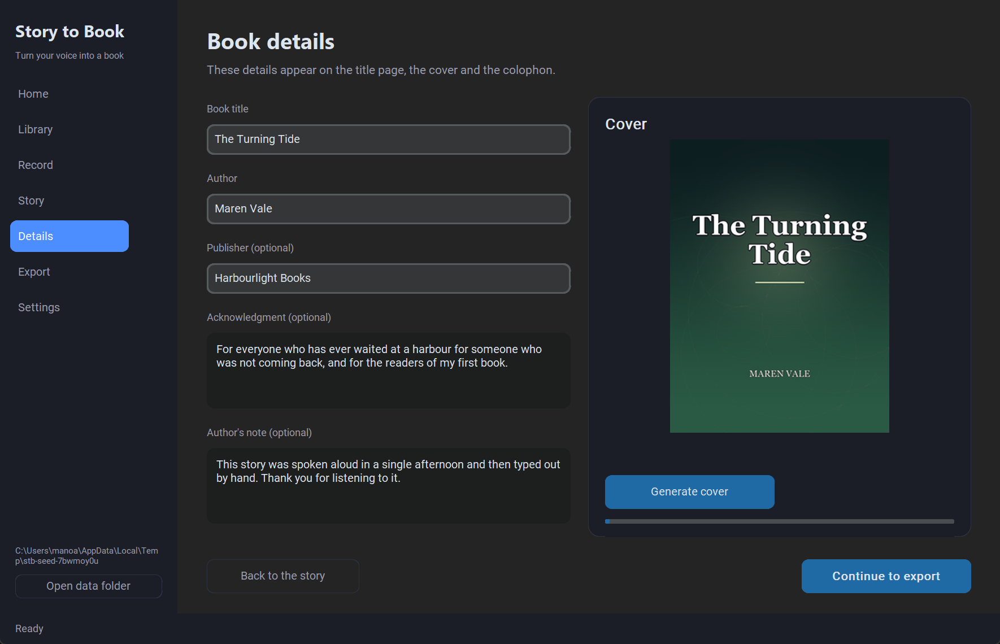
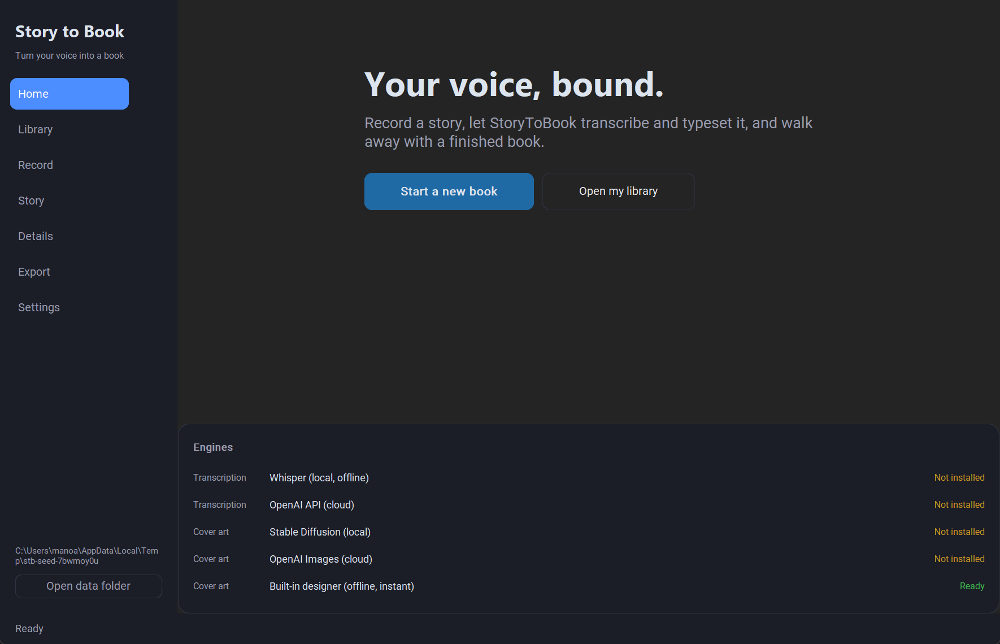
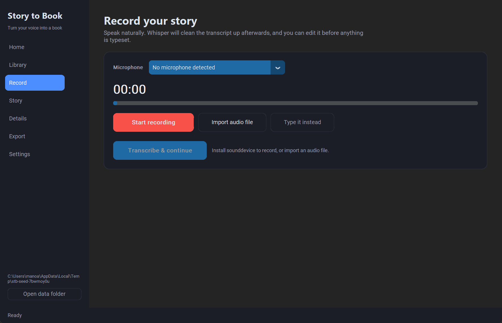
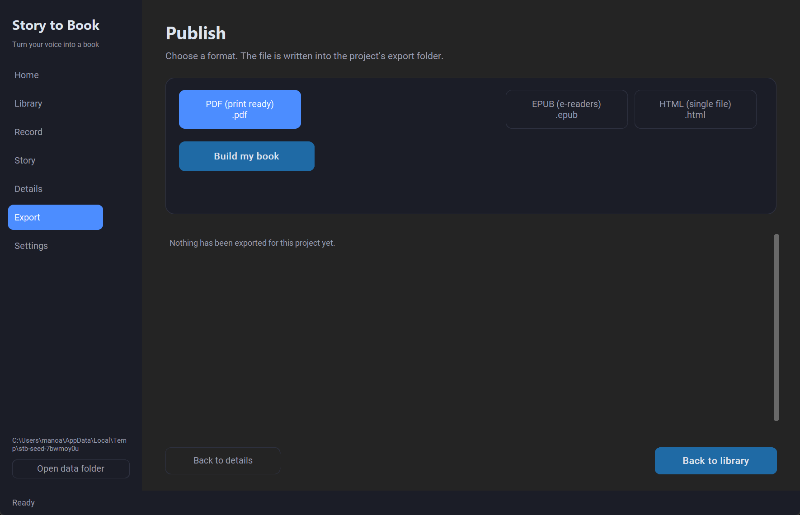
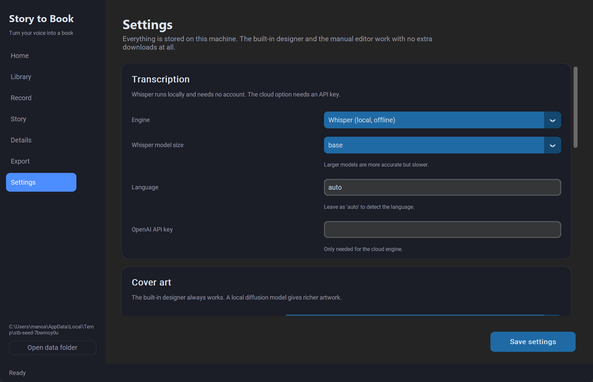

# StoryToBook

StoryToBook is a desktop application that turns a spoken story into a finished, typeset book.
Record a story (or type it), let the app transcribe and clean up the text, split it into
chapters, design a cover and export the result as a print-ready PDF, an EPUB for e-readers
or a single self-contained HTML file. Everything happens on your own machine: the interface
is a local CustomTkinter app and the project files are plain folders you can back up, sync
or move between machines.

**What it does**

- Records from the microphone with a live level meter, or imports an existing audio file.
- Transcribes with local Whisper (offline) or the OpenAI API, then normalises the raw text.
- Splits the transcript into chapters from spoken "Chapter N" markers or by target length.
- Lets you edit the transcript, rename, reorder and delete chapters before anything is typeset.
- Designs a cover with the built-in procedural designer, a local Stable Diffusion model
  (optionally with a LoRA adapter) or the OpenAI Images API.
- Exports A5 PDF, EPUB 3 and single-file HTML with the cover embedded.
- Keeps every project in a normal folder on disk, with a searchable library of all of them.

## Screenshots

  

   

The images are captured from the running application with
`python scripts/screenshot_seeded.py docs/screenshots`. The script seeds a
sample project, then walks through every screen and writes one PNG per view.

## Features

**Record**

- Microphone picker with a default-device option and a live input level meter.
- Records mono 44.1 kHz audio straight into the project folder as `source.wav`.
- Import an existing recording (`.wav`, `.mp3`, `.m4a`, `.flac`, `.ogg`, `.aac`).
- "Type it instead" skips recording completely and hands you an empty editor.

**Edit**

- Full transcript editor with live word count, reading time and character count.
- Automatic clean-up of raw speech-to-text: unicode normalisation, smart punctuation folded to ASCII, collapsed whitespace and blank lines.
- Chapter titles can be renamed, reordered or removed; the transcript is saved as you type.

**Structure**

- Detects spoken chapter markers such as "Chapter 3" or "Chapter One" and splits on them.
- Falls back to splitting by target word count, always on a sentence boundary.
- Target length is adjustable per project and remembered in the settings.

**Cover art**

- Built-in procedural designer: gradient background, genre-derived palette, ornament and typography. No downloads, no GPU, always available.
- Local Stable Diffusion through `diffusers`, with optional LoRA adapter support.
- OpenAI Images for cloud rendering, with the title and author typeset on top.
- Genre detection picks a palette and a prompt from the story text.

**Publish**

- A5 PDF with cover, title page, acknowledgment, author's note, table of contents, chapters and a colophon, plus page numbers.
- EPUB 3 with a navigation document, one XHTML file per chapter and the cover image.
- Single-file HTML with the stylesheet inlined and the cover embedded as a data URI.
- Every export is written into the project's `exports/` folder and listed in the app.

**Project library**

- Dashboard with project count, chapter count and total word count.
- Search by title or author, duplicate a project, delete a project and everything it produced.
- Status badges track a project from *Draft* through *Published*.

## Install

Python 3.10 or newer is required (the app is developed on 3.14).

```bash
git clone https://github.com/Manohargov/StoryToBookApp.git
cd StoryToBookApp

python -m venv .venv
source .venv/bin/activate          # Windows PowerShell: .venv\Scripts\activate

python -m pip install -r requirements.txt
```

The package uses a `src/` layout, so it has to be on the import path. Either install the
project itself:

```bash
python -m pip install -e .

storytobook              # console script
python -m storytobook    # the same entry point
```

or run it straight from the checkout without installing anything:

```bash
# macOS / Linux
PYTHONPATH=src python -m storytobook

# Windows PowerShell
$env:PYTHONPATH="src"; python -m storytobook
```

## Optional extras

The base install already contains everything that is needed to produce a book: the editor,
the built-in cover designer and all three exporters. The extras add the AI engines, and
each one is completely optional — the app degrades gracefully and tells you on the Home
screen which engines are ready.

| Extra | Install | What it enables |
|---|---|---|
| `audio` | `pip install -e ".[audio]"` | Microphone recording (adds `sounddevice`) |
| `transcription` | `pip install -e ".[transcription]"` | Local, offline Whisper transcription (adds `openai-whisper`) |
| `cover` | `pip install -e ".[cover]"` | Local Stable Diffusion cover art (adds `torch`, `diffusers`, `transformers`, `accelerate`) |
| `cloud` | `pip install -e ".[cloud]"` | OpenAI cloud transcription and OpenAI Images cover art (adds `openai`, needs an API key) |
| `dev` | `pip install -e ".[dev]"` | `pytest`, `pytest-cov` and `ruff` for development |

Without any extras the app still records (that needs the `audio` extra), types the story
in the editor, draws covers with the built-in designer and exports PDF, EPUB and HTML.
In other words: installing `sounddevice` is the only optional package you need to use the
whole application, and even that can be replaced by importing an audio file or by typing.

## How it works

The pipeline is a straight line, and every step can be run on its own:

```
record  ->  transcribe  ->  chapter  ->  cover  ->  export
```

1. **Record** — audio is captured into `<project>/audio/source.wav`, or imported from a file.
2. **Transcribe** — the selected provider turns the audio into text. The result is
   normalised (whitespace, punctuation, unicode) and stored both in `project.json` and in
   a plain `transcript.txt` next to it.
3. **Chapter** — the transcript is split into chapters. Spoken "Chapter N" markers win;
   otherwise the text is grouped by target length on sentence boundaries.
4. **Cover** — a cover image is rendered into `<project>/cover.png`.
5. **Export** — the book is written into `<project>/exports/` in the chosen format.

Long-running steps (transcription, cover generation, export) run on a worker thread and
report progress into the status bar, so the interface never freezes.

### Chaptering rules

- A marker is a spoken `Chapter` followed by a number in Arabic or Roman numerals
  ("Chapter 3", "Chapter One"). The text after the marker becomes the chapter title.
- Only an ascending run of at least two markers is used, so ordinary sentences that
  happen to contain the word "chapter" are ignored.
- Without markers the transcript is grouped into chapters of roughly the target length
  (default 1000 words, adjustable in Settings), and a chapter never starts in the middle
  of a sentence.
- A single sentence longer than 1.6 times the target is split on word boundaries, and a
  trailing chapter shorter than a few dozen words is merged back into the previous one.

## Where your files live

All application data is kept in one folder so a project can be backed up or moved as a
single unit.

| Platform | Location |
|---|---|
| Windows | `%LOCALAPPDATA%\StoryToBook` |
| macOS | `~/Library/Application Support/StoryToBook` |
| Linux | `~/.local/share/StoryToBook` |

Set the `STORYTOBOOK_HOME` environment variable to use a different folder; it overrides
the platform default. The test-suite uses the same variable to stay hermetic. The folder
that is currently in use is shown in the sidebar and under *Settings → Storage*, and the
"Open data folder" button opens it in your file manager.

```text
<data dir>/
├── settings.json                 # user settings
├── logs/                         # application logs
└── library/
    └── <project id>/
        ├── project.json          # metadata, transcript and chapters
        ├── transcript.txt        # plain text copy of the transcript
        ├── audio/
        │   └── source.wav        # the recording
        ├── cover.png             # generated cover art
        └── exports/              # rendered books
            ├── My Story.pdf
            ├── My Story.epub
            └── My Story.html
```

## Configuration

Settings are edited in the *Settings* screen and stored in `settings.json` inside the
data folder. Unknown or hand-edited values are clamped to safe ranges when the file is
read.

| Setting | Options | Default |
|---|---|---|
| Transcription engine | Whisper (local, offline), OpenAI API (cloud) | `whisper_local` |
| Whisper model size | `tiny`, `base`, `small`, `medium`, `large` | `base` |
| Language | `auto` or a language code such as `en` | `auto` |
| OpenAI API key | free text, only needed for the cloud engine | empty |
| Cover engine | Built-in designer, Stable Diffusion (local), OpenAI Images (cloud) | auto-detected |
| Diffusion model | a checkpoint id on Hugging Face | `stable-diffusion-v1-5/stable-diffusion-v1-5` |
| LoRA adapter | on/off plus the folder that holds the adapter | off |
| Steps / Guidance | 1–150 / 0.0–20.0 | `30` / `7.5` |
| Cover size | width x height in pixels | `1200 x 1600` |
| Extra prompt | additional art direction for the cover | empty |
| Chapter length | words per chapter, minimum 100 | `1000` |
| Appearance | `dark`, `light`, `system` | `dark` |
| Accent colour | `blue`, `green`, `dark-blue`, `light-blue` | `blue` |
| Default export format | `pdf`, `epub`, `html` | `pdf` |

The cover engine setting of *auto* is not offered in the menu but is the built-in default:
it picks the first provider that is actually installed and falls back to the built-in
designer, which always works.

## Using a LoRA adapter

The local diffusion provider loads a **base checkpoint** first and merges a **LoRA
adapter** on top of it. The two are separate artefacts:

- The base checkpoint is a full model on Hugging Face, named in *Settings → Diffusion
  model*. The default is `stable-diffusion-v1-5/stable-diffusion-v1-5`.
- The LoRA adapter is a small folder with **both** `adapter_config.json` **and**
  `adapter_model.safetensors` in it.

The `fine_tuned_model/` folder in this repository only contains an `adapter_config.json`.
That is a configuration file without any weights, so it cannot be used as an adapter: the
weights are the part that actually changes the image. To use a real adapter, either drop
a trained adapter (config **and** `adapter_model.safetensors`) into that folder or point
*Settings → LoRA → Adapter folder* at one somewhere else, and switch the LoRA toggle on.

The adapter should be trained for the same base model that is configured; the merge is
applied with `pipe.load_lora_weights(...)` and then fused when the installed `diffusers`
version supports it. Weights larger than a few hundred megabytes are ignored by git, so
keep them out of the repository.

## Development

```bash
git clone https://github.com/Manohargov/StoryToBookApp.git
cd StoryToBookApp

python -m venv .venv
source .venv/bin/activate          # Windows PowerShell: .venv\Scripts\activate

python -m pip install -r requirements.txt -r requirements-dev.txt
```

Run the application straight from the source tree:

```bash
# macOS / Linux
PYTHONPATH=src python -m storytobook

# Windows PowerShell
$env:PYTHONPATH="src"; python -m storytobook
```

Run the tests and the linter:

```bash
python -m pytest          # the full suite
python -m pytest -q       # quiet
ruff check .              # lint
ruff check . --fix        # lint and apply the safe fixes
```

Build every screen headlessly to check that the interface still comes up:

```bash
python scripts/smoke_ui.py
```

The script points the data directory at a temporary folder, so it never touches your real
library. It navigates through every page and prints `SMOKE TEST OK` when all of them
built successfully.

## Project layout

```text
StoryToBookApp/
├── src/
│   └── storytobook/
│       ├── __init__.py
│       ├── __main__.py            # python -m storytobook
│       ├── app.py                 # window, navigation, background workers
│       ├── errors.py              # exception hierarchy
│       ├── paths.py               # data directory locations
│       ├── settings.py            # settings model and persistence
│       ├── version.py
│       ├── domain/                # pure data, no UI and no I/O
│       │   ├── chapter.py         # chapter splitting
│       │   ├── project.py         # the project model
│       │   └── text.py            # normalisation and sentence splitting
│       ├── exporters/             # output formats
│       │   ├── base.py            # document model and exporter contract
│       │   ├── epub.py
│       │   ├── html.py
│       │   ├── pdf.py
│       │   └── registry.py
│       ├── providers/             # pluggable engines
│       │   ├── cover/
│       │   │   ├── base.py
│       │   │   ├── diffusers_local.py
│       │   │   ├── openai_api.py
│       │   │   ├── pillow_fallback.py
│       │   │   ├── theme.py       # genre detection and prompts
│       │   │   └── typography.py
│       │   └── transcription/
│       │       ├── base.py
│       │       ├── openai_api.py
│       │       └── whisper_local.py
│       ├── services/              # orchestration
│       │   ├── audio.py           # microphone capture
│       │   ├── library.py         # projects on disk
│       │   └── pipeline.py        # record -> book pipeline
│       └── ui/                    # CustomTkinter interface
│           ├── pages/
│           │   ├── base.py
│           │   ├── dashboard.py   # Library
│           │   ├── details.py     # Details
│           │   ├── export.py      # Export
│           │   ├── landing.py     # Home
│           │   ├── recording.py   # Record
│           │   ├── settings.py    # Settings
│           │   └── transcript.py  # Story
│           ├── system.py
│           └── theme.py
├── scripts/
│   ├── screenshot.py
│   ├── screenshot_seeded.py
│   └── smoke_ui.py
├── tests/
├── docs/screenshots/
├── fine_tuned_model/              # placeholder for a LoRA adapter
├── pyproject.toml
├── requirements.txt
└── requirements-dev.txt
```

## Troubleshooting

**No microphone detected**
The device menu shows "No microphone detected" when `sounddevice` is missing or the
system has no input device. Install the audio extra with `pip install -e ".[audio]"`
(on Linux you may also need `portaudio19-dev`), or use *Import audio file*, or type the
story instead.

**Whisper is not installed**
Transcription reports that the `openai-whisper` package is missing. Install it with
`pip install -e ".[transcription]"` and choose a model size, or switch the engine to
*OpenAI API* and add an API key. Without either, use *Type it instead* and paste the text.

**The diffusion model will not download**
The first run downloads several gigabytes from Hugging Face and needs a working
connection. Check the model id in *Settings → Diffusion model*, make sure the Hugging Face
cache directory is writable, and be patient. Until the model is available, the built-in
designer still produces a cover.

**The LoRA adapter is rejected**
The adapter folder must contain `adapter_config.json` *and* `adapter_model.safetensors`.
The `fine_tuned_model/` folder in this repository only has the configuration, so it
cannot be used on its own. The adapter also has to match the configured base checkpoint.

**PDF characters look wrong**
The PDF exporter embeds a system TrueType font when it can find one, which keeps
unicode intact. Without such a font it falls back to the built-in Helvetica core font and
transliterates the text to latin-1, so accents disappear. Install a standard font
(Georgia, Arial, Segoe UI, Calibri or DejaVu) or export to EPUB or HTML instead.

**The app data is in the wrong place**
The data directory is `%LOCALAPPDATA%\StoryToBook`, `~/Library/Application Support/StoryToBook`
or `~/.local/share/StoryToBook`, depending on the platform. Set `STORYTOBOOK_HOME` to
move it, and use the "Open data folder" button to see the folder that is actually in use.

## License

MIT. See [LICENSE](LICENSE) for the full text.
